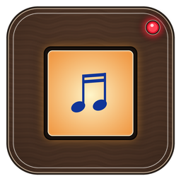
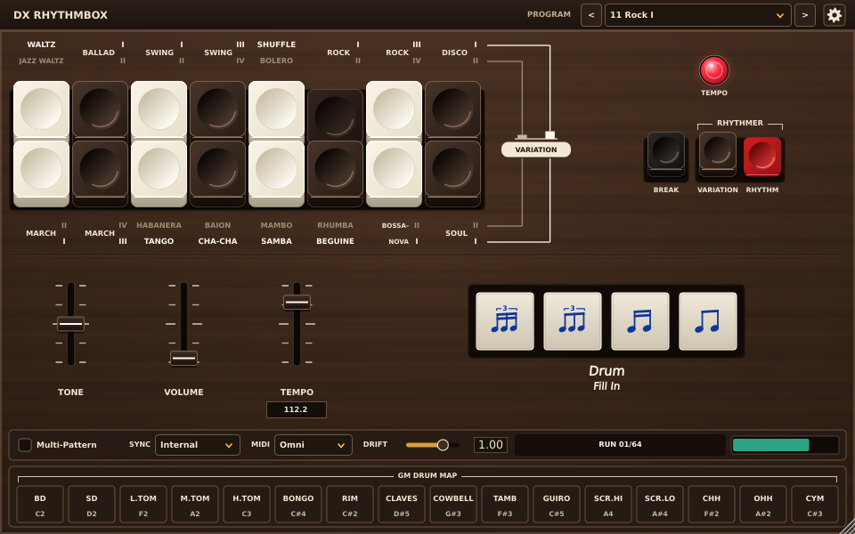
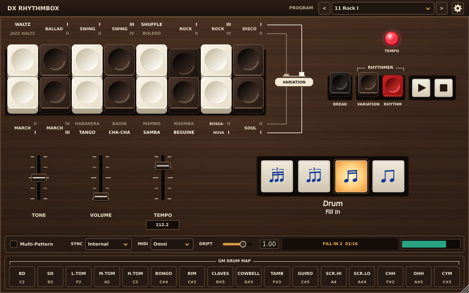
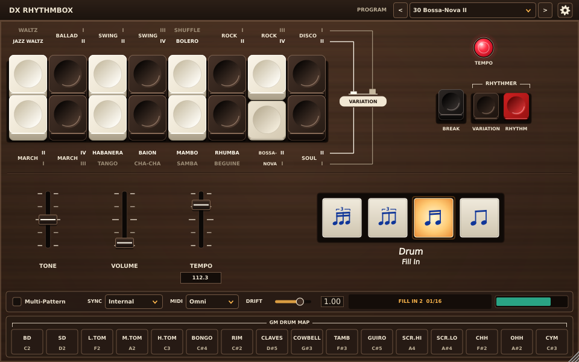
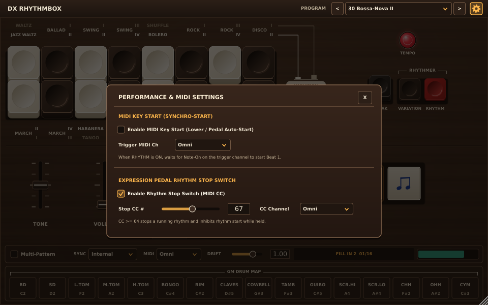

<p align="center">
  
</p>

<h1 align="center">DX Rhythmbox</h1>
<p align="center">
  by <strong>Yuguen Organ (ゆうげんオルガン)</strong><br>
  1982 Vintage Analog Rhythm Box Physical Model &mdash; VST3 / macOS AudioUnit (AU) / Standalone
</p>
<p align="center">
  <em>Current Status: Alpha Release (<code>v0.1.0-alpha</code>) &bull; License: GPLv3</em>
</p>

<p align="center">
  
</p>

<details>
<summary>Standalone Mode, Illuminated Drum Fill-In &amp; Settings View Screenshots / スタンドアローン画面・フィルイン点灯・設定画面スクリーンショット</summary>

<p align="center">
  <strong>Standalone Mode (with Cream Play / Stop Transport Buttons)</strong><br>
  
</p>

<p align="center">
  <strong>Drum Fill-In Illuminated (VARIATION Active &amp; Amber Bulb Glow)</strong><br>
  
</p>

<p align="center">
  <strong>Performance &amp; MIDI Settings Overlay (MIDI Key Start &amp; Rhythm Stop CC)</strong><br>
  
</p>

</details>

---

## Overview / 概要

**DX Rhythmbox** (`v0.1.0-alpha`) is a real-time C++20 physical modeling instrument (`JUCE 8`) inspired by the built-in transistor percussion and rhythm unit of a 1982 Japanese electronic home organ (**DX701**). Every percussion instrument, wired-OR pattern matrix, break/fill-in sequencer, and passive tone-balance circuit is synthesized mathematically in real time with **zero audio samples**.

**DX Rhythmbox**（`v0.1.0-alpha`）は、1982年頃の日本製電子オルガン（DX701）に搭載されていたトランジスタ音源リズムボックスに着想を得た、**Yuguen Organ（ゆうげんオルガン）** によるリアルタイム物理モデル音源プラグイン（C++20 / JUCE 8 / VST3・AU・Standalone）です。全16種類の打楽器音源、ワイヤードORによるリズム合成、フィルイン／ブレイク回路、パッシブトーン回路に至るまで、オーディオサンプルを一切使用せず完全リアルタイム演算で再現しています。

> [!NOTE]
> This is an **Alpha release (`v0.1.0-alpha`)**. Bug reports, UI/UX feedback, and DAW compatibility reports via GitHub Issues are very welcome.

---

## Key Features / 主な機能

- **16 Real-Time Synthesized Percussion Voices (Zero Samples)**
  - Bass Drum (`BD`), Snare Drum (`SD`), Low/Mid/High Toms (`L.TOM`, `M.TOM`, `H.TOM`), Bongo (`BONGO`), Rim Shot (`RIM`), Claves (`CLAVES`), Cowbell (`COWBELL`), Tambourine (`TAMB`), Guiro (`GUIRO`), High & Low Scratch (`SCR.HI`, `SCR.LO`), Closed/Open Hi-Hat (`CHH`, `OHH`), and Crash Cymbal (`CYM`).
  - Bottom **`GM DRUM MAP`** audition bar displays each voice with its international scientific pitch name (`C2`–`D#5`), supports velocity-responsive click audition, and flashes in sync with incoming MIDI drum triggers.

- **32 Hardware Rhythm Patterns + `VARIATION` & Wired-OR `Multi-Pattern`**
  - Tactile 2&times;8 mechanical pushbutton matrix paired with `VARIATION` (32 factory rhythms across `WALTZ` / `JAZZ WALTZ`, `BALLAD I–II`, `SWING I–IV`, `SHUFFLE` / `BOLERO`, `ROCK I–IV`, `DISCO I–II`, `MARCH I–IV`, `TANGO` / `HABANERA`, `CHA-CHA` / `BAION`, `SAMBA` / `MAMBO`, `BEGUINE` / `RHUMBA`, `BOSSA-NOVA I–II`, and `SOUL I–II`).
  - **`Multi-Pattern`** checkbox and multi-button gestures model Wired-OR pattern combination (up to 4 patterns simultaneously).
  - All 32 rhythms are available via the top **PROGRAM** selector for instant host recall.

- **Authentic Performance Controls, `Drum Fill In` & `BREAK`**
  - **`RHYTHM`** (Red switch): Arms/enables the rhythm unit (does **not** auto-start on toggle-ON). Turning `RHYTHM` OFF stops playback immediately.
  - **`BREAK`** (Left of `RHYTHMER`): Latching hold-to-play mode &mdash; when `RHYTHM` is armed and `BREAK` is ON, playback starts from Beat 1 **only while** a MIDI trigger key or the Standalone Play button is held, and stops immediately on release.
  - **`Drum Fill In` (4 Keys + Intro Auto-Continue)**: Self-illuminating square keys for 16th-note triplets, 8th-note triplets, 16th notes, and 8th notes. Pressing any Fill-In while stopped with a pattern selected plays a 1-bar intro and continues seamlessly into the rhythm (or plays 1 bar standalone when no rhythm is selected).
  - **Standalone Play (`▶`) / Stop (`■`)**: Dedicated cream tactile buttons shown right of `RHYTHMER` in the Standalone app, decoupled from the `RHYTHM` enable switch to trigger Beat 1 playback or emulate the foot-pedal stop switch.

- **Tone, Inverted Hardware Faders, Direct BPM Input & Sync**
  - **`TONE`**: Passive dual-bus tilt control between Drums (`DARK`) and Cymbals (`BRIGHT`) with exact bit-clean bypass at `CENTER`.
  - **`VOLUME`** & **`TEMPO`**: Inverted hardware vertical faders (top MIN &rarr; bottom MAX). **`TEMPO`** covers **`40.0–300.0 BPM`** with a compact **direct BPM text input** grouped right beneath the `TEMPO` caption.
  - Ruby **Tempo Jewel Lamp** flashing on every beat and **`DRIFT`** (`Analog Drift` `0.00–1.50`).
  - **`SYNC`** modes: `Internal`, `Host Tempo` (follows DAW BPM), and `Host Sync` (locks to DAW transport & PPQ).

- **Gear Icon Settings (`PERFORMANCE & MIDI SETTINGS`)**
  - **MIDI Key Start (Synchro-Start)**: Starts an armed rhythm from Beat 1 upon receiving `Note-On` on `Omni` or `Ch 1..16`.
  - **Expression Pedal Rhythm Stop Switch**: Assignable MIDI CC (`0..127`, default `CC#67`, channel `Omni` or `Ch 1..16`); `CC >= 64` stops a running rhythm and inhibits start while held.
  - Independent **`MIDI`** channel selector (`Omni / Ch 1..16 / Off`) for playing the 16 drum voices via GM MIDI.

---

## Download & Installation / ダウンロードと導入方法

Pre-built binaries are published on the [GitHub Releases](../../releases) page (`.zip` archives for **Windows x64**, **macOS Universal `arm64+x86_64`**, and **Linux x64**).

### Windows (x64)
- **VST3**: Copy `DX Rhythmbox.vst3` into `C:\Program Files\Common Files\VST3\`
- **Standalone**: Run `DX Rhythmbox.exe` directly from any folder
- **Audio Driver Note**: The Standalone app uses **Windows Audio (WASAPI Shared / Exclusive / Low Latency)** and **DirectSound** (proprietary ASIO drivers are not bundled). To use an ASIO audio interface directly, load `DX Rhythmbox.vst3` inside an ASIO-compatible DAW or VST3 host.

### macOS (Apple Silicon + Intel Universal)
- **VST3**: Copy `DX Rhythmbox.vst3` to `/Library/Audio/Plug-Ins/VST3/`
- **AudioUnit (AU)**: Copy `DX Rhythmbox.component` to `/Library/Audio/Plug-Ins/Components/`
- **Standalone**: Copy `DX Rhythmbox.app` to `/Applications/`

> [!IMPORTANT]
> **macOS Gatekeeper Notice (Unsigned Alpha Builds)**
> Because alpha builds are not yet Apple-notarized, macOS may show a *"cannot be opened / damaged"* warning on first launch. After copying the files, clear the quarantine attribute in Terminal:
> ```bash
> xattr -cr "/Library/Audio/Plug-Ins/VST3/DX Rhythmbox.vst3"
> xattr -cr "/Library/Audio/Plug-Ins/Components/DX Rhythmbox.component"
> xattr -cr "/Applications/DX Rhythmbox.app"
> ```

### Linux (x64)
- **VST3**: Copy `DX Rhythmbox.vst3` to `~/.vst3/`
- **Standalone**: Make `DX Rhythmbox` executable (`chmod +x "DX Rhythmbox"`) and run it

---

## Build from Source / ソースからのビルド

Requirements: CMake >= 3.22, a C++20 compiler, Git, and internet access (to fetch JUCE 8.0.6 and Catch2 v3.7.1 via `FetchContent`).

```bash
# Configure & Build (Release VST3 / AU / Standalone / Catch2 Tests)
cmake -B build -DCMAKE_BUILD_TYPE=Release
cmake --build build --parallel

# Run all 17 Catch2 DSP & Plugin unit tests
ctest --test-dir build --output-on-failure -V
```

*(On Linux, pass `-G Ninja` if using Ninja; on macOS Universal builds, add `-DCMAKE_OSX_ARCHITECTURES="arm64;x86_64"`.)*

---

## License & Disclaimer / ライセンス・免責事項

- **License**: Released under the **GNU General Public License v3.0 (GPLv3)** (compatible with JUCE 8 open-source licensing). The copyright holder (**Yuguen Organ**) retains the right to distribute this software under separate commercial or proprietary license terms. By submitting a Pull Request or contribution to this repository, you agree that your contribution may be licensed and distributed under both GPLv3 and separate commercial terms; see [LICENSE](LICENSE) for full details.
- **Framework**: Built with [JUCE 8](https://juce.com/).
- **Disclaimer**: *DX Rhythmbox* is an independent software modeling project created by **Yuguen Organ (ゆうげんオルガン)**. It is not affiliated with, endorsed by, or sponsored by any hardware musical instrument manufacturer. All rhythm names and percussion voice labels refer to traditional electronic organ terminology.
